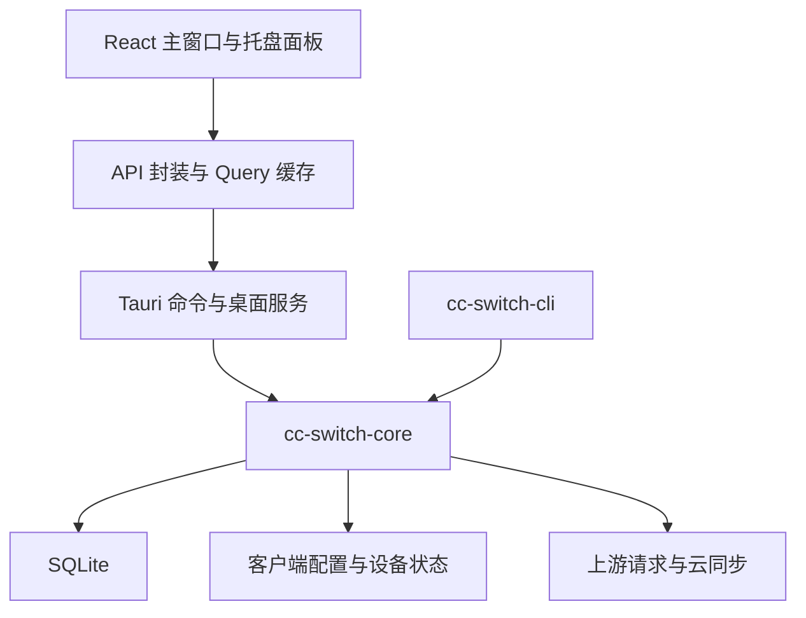

# 当前架构与模块边界

核对日期：2026-11-26。对应当前工作树，功能模块编号见[模块划分](../PROJECT_MODULE_REVIEW_PLAN.md)，验证方法见[测试指南](testing.md)。

## 运行入口与依赖

| 层次         | 入口                                                         | 主要职责                                               |
| ------------ | ------------------------------------------------------------ | ------------------------------------------------------ |
| 主窗口       | [App.tsx](../src/App.tsx)、`src/components/`                 | 页面导航、编辑状态、业务交互                           |
| 托盘面板     | [TrayPanel.tsx](../src/tray-panel/TrayPanel.tsx)             | 独立窗口、状态快照、快捷操作与用量                     |
| 前端数据访问 | `src/lib/api/`、`src/lib/query/`、`src/hooks/`               | IPC 契约、读取与缓存、事件订阅、操作后刷新             |
| 桌面适配     | [lib.rs](../src-tauri/src/lib.rs)、`src-tauri/src/commands/` | Tauri 注册、窗口生命周期、系统集成、桌面专属服务       |
| 共用核心     | [core/lib.rs](../crates/cc-switch-core/src/lib.rs)           | 数据库、原生配置、供应商、路由、会话、同步等可复用业务 |
| 独立 CLI     | [cli/main.rs](../crates/cc-switch-cli/src/main.rs)           | 命令解析、核心装配、输出和进程管理                     |

三个 Rust crate 分别由各自的 `Cargo.toml` 构建，仓库根目录没有 Cargo workspace。GUI 和 CLI 通过路径依赖复用 core；core 不依赖 Tauri、GTK 或 WebKit。CLI 关闭 core 默认的 `session-monitor` feature，但保留代理请求日志。`test-support` 仅提供跨 crate 的测试辅助。

桌面 crate 中部分模块是兼容导出，通用实现位于 `crates/cc-switch-core/src/`。维护或移植上游改动时先确认实际定义所在，避免在桌面层重新复制数据库、代理和配置实现。

## 共享类型、能力与宿主能力

- 核心应用身份在 [app.rs](../crates/cc-switch-core/src/app.rs)，`AppType::SUPPORTED` 收敛为 5 个客户端（`claude`、`codex`、`opencode`、`dsh`、`agy`）；历史变体保留在 `AppType::persisted()` 用于兼容读取已有数据库和同步归档。共享供应商身份、图标、模型、定价等规则分别有独立模块。
- 前端 [appCapabilities.ts](../src/config/appCapabilities.ts) 提供不依赖 React 的受管应用列表（`APP_IDS`）、路由与聚合能力（`MODE_APP_IDS` / `PROXY_APP_IDS` / `STACK_APP_IDS` 面向 Claude Code 和 Codex）、MCP/Skills 能力；[appConfig.tsx](../src/config/appConfig.tsx) 负责展示配置。
- [runtime_hooks.rs](../crates/cc-switch-core/src/runtime_hooks.rs) 组合宿主注入能力；[events.rs](../crates/cc-switch-core/src/events.rs) 表达业务事件，桌面通过 [frontend_hooks.rs](../src-tauri/src/frontend_hooks.rs) 适配 Tauri。
- [startup.rs](../crates/cc-switch-core/src/startup.rs) 装配数据库变更观察者及本地定价同步。数据库通过 [changes.rs](../crates/cc-switch-core/src/database/changes.rs) 通知外部，不在 DAO 内直接绑定某个云同步实现。

## 读取、显式同步与缓存

供应商只读目录与原生配置同步分离：`ProviderService::list` 读取已保存目录，`refresh` 执行原生配置协调并传播失败。前端的普通查询不应偷偷写回客户端配置；需要同步的入口通过 `refresh_providers` 明确执行。

[providerActions.ts](../src/lib/query/providerActions.ts) 组织供应商操作，[providerCache.ts](../src/lib/query/providerCache.ts) 集中应用级失效规则；代理（[proxyKeys.ts](../src/lib/query/proxyKeys.ts)）、用量（[usageKeys.ts](../src/lib/query/usageKeys.ts)）、提示词（[prompts.ts](../src/lib/query/prompts.ts)）、会话（[sessions.ts](../src/lib/query/sessions.ts)）等使用独立 Query Key 模块（保留的历史兼容模块不作为当前界面入口）。跨资源恢复通过 [invalidation.ts](../src/lib/query/invalidation.ts) 先取消旧查询再失效，防止迟到结果盖过恢复后的数据。

[useTauriEvent.ts](../src/hooks/useTauriEvent.ts) 与 [tauriEventCleanup.ts](../src/lib/tauriEventCleanup.ts) 管理订阅生命周期。卸载、订阅失败及重复清理都属于事件适配的错误处理范围。

## 持久化与原生配置

SQLite 保存供应商档案、MCP、提示库、Skills 元数据、项目、用量等；技能文件和客户端原生配置仍保存在文件系统。设备设置由 `settings.json` 保存，不随云同步传输。当前设置文件跟随 CC Switch 配置目录，其他本机状态文件的路径见[配置文件说明](user-manual/zh/5-faq/5.1-config-files.md)。

[database/](../crates/cc-switch-core/src/database/) 集中连接、SQL、迁移、DAO、备份和持久化测试；连接与内部缓存的访问限制在核心库内。SQL 导入通过临时数据库校验，检查 schema、完整性和外键后才替换有效数据。

[live/](../crates/cc-switch-core/src/live/) 将配置字段所有权、投影、补丁和写入分开。切换式客户端只替换受管关键字段；累加式客户端管理原生文件中的供应商成员，具体默认项和删除约束由客户端适配决定。

[coordination.rs](../crates/cc-switch-core/src/coordination.rs) 提供按应用的共享操作锁；模式转换与恢复由 `mode/` 编排。MCP 的写入计划先准备原生变更，失败时补偿，最后提交数据库。普通原子写入可以避免半个文件，但多文件和数据库仍不是一个跨资源事务。

## 托盘、深链接与窗口

- `tray.rs`、`tray_panel.rs` 管理原生菜单、快捷面板、布局与状态通知。面板使用 [usePanelState.ts](../src/tray-panel/usePanelState.ts) 串行读取并合并通知，忽略过期和卸载后的结果；隐藏后停止主动刷新和用量轮询。
- 显示主窗口、轻量模式切换和第二实例唤起共用生命周期锁。等待锁及窗口重建安排在后台，避免阻塞重建所需的主事件线程。
- 深链接先解析，再通过带 ID 的待处理项交给确认框；确认框显示后才确认消费。URL 和 Base64 字段有 256 KiB 上限，参数最多 64 个，拒绝重复参数和非法类型，合并后的地址再次校验。
- 导入提交与导入后的缓存刷新分别处理失败，防止已落盘后因刷新报错引导重复导入。协议和资源支持范围见[深链接手册](user-manual/zh/5-faq/5.3-deeplink.md)。
- 轻量模式销毁主窗口并持久化偏好；重新打开时恢复窗口的平台装饰和工作区尺寸。Linux AppImage 自启使用持久的启动文件路径。

## 仍需保留的边界

1. 按应用互斥锁不能阻止其他进程改写同一文件；原子写入、revision 冲突检测和恢复逻辑需共同维护。
2. 多资源提交的正常错误回滚不等于断电一致性。不要把局部成功写成整个数据库和客户端文件已原子提交。
3. S3/WebDAV 自动上传前的 manifest 比较能发现已发生的冲突，但比较与上传之间仍有竞争窗口；下载校验不能使多设备上传成为事务。
4. 模拟 IPC、纯函数测试和 Windows 单元测试不覆盖真实桌面交互、Unix 权限/软链接、在线授权或跨平台安装包。
